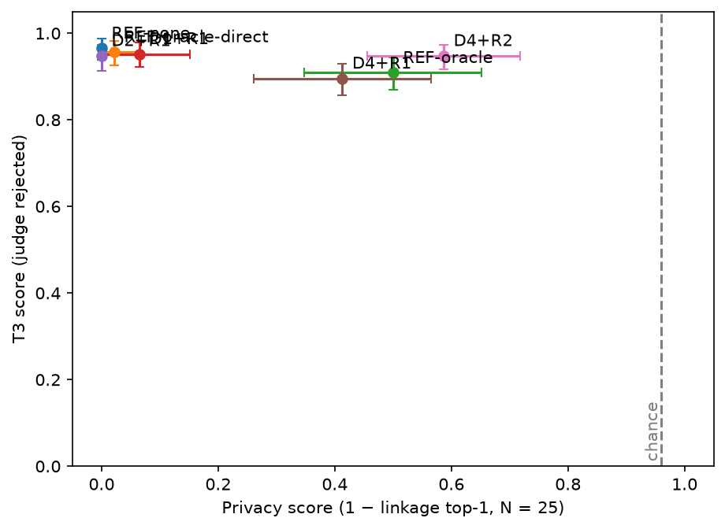

# Omissis

A local tool that sits between a user and a cloud LLM. For Italian text it detects
sensitive spans, replaces them with pseudonyms, sends the pseudonymised text to the
model, restores the real values in the reply and reports what was disclosed.

The contribution is the measurement: what each configuration costs in privacy
(re-identification risk against an attacker LLM) and in answer quality.

Team project for *AI Frontiers: Large Language Models* (LUISS, fall 2026).

## What it is and what it is not

- It **is** a pseudonymiser for one Italian text at a time (bank and HR
  correspondence), with a session vault that lives in memory, a restoration step
  that reports every value it could not put back, and an evaluation that measures
  what an attacker LLM can still infer.
- It is **not** an anonymiser. Pseudonymised text can still be re-identified,
  and the evaluation measures that risk. It does not encrypt or persist the vault,
  does not handle attachments, other languages or multi-turn chats, and has not
  been tested on real personal data: every person and value in this repository is
  invented.

## Quick start

Requires [`uv`](https://docs.astral.sh/uv/) and `make`. `uv` installs Python 3.11.

```
make setup              # create the environment from uv.lock
make test               # unit and integration tests
make lint               # ruff check and format check
cp .env.example .env    # then write your GroqCloud key in GROQ_API_KEY
```

Only the commands that call a hosted model need the key in `.env`, and they read
it through `uv run --env-file .env ...`. The detectors D1 to D4 need two more
things, which `make setup` and CI do not install:

```
uv sync --locked --group detect   # Presidio, spaCy and it_core_news_lg, transformers
ollama pull gpt-oss:20b           # the local model of D3, with Ollama running
```

The weights of D2 are read from the local Hugging Face cache (model and revision
in `configs/models.yaml`). Without the `detect` group the tests that need it are
skipped.

## Run one text

```
uv run omissis run --config configs/skeleton.yaml --input data/fixtures/fx-bank-01.json
```

This runs the whole pipeline on a synthetic fixture with detector D0 and
placeholders R1. Every model role points to the built-in `echo` provider, which
returns the prompt unchanged, so the command needs no network and no key. The
command prints the masked text, the reply, the restored reply and the disclosure
report to standard output. The restored reply holds the original values: do not
redirect it under `results/`. A run configuration (`docs/interfaces.md`,
section 4) chooses the detector, the strategy and the backend: `cloud` calls the
model, and `replay` answers from the cache only.

`--task` sets the request sent before the text (the default asks for a draft
reply). Before sending, `run` checks it: a request for a calculation (a total, a
difference, a percentage) on a text where amounts, dates or ages were masked is
not sent, and the command ends with one line on standard error and status 2.
With `configs/skeleton.yaml` amounts stay visible, so nothing is stopped.

## Demo

```
make demo
```

This starts a Gradio page in replay mode, with no network: one fixture at a
time, the masked text as it is sent, the restored reply and the disclosure list.
**Not ready yet:** the page starts, but its runs have not been recorded in
`results/cache/` (step C4 of `docs/TODO.md`), so every fixture ends in a cache
miss.

The field *Richiesta* holds the request sent before the text. A request for a
calculation on masked amounts is not sent, and the page says why. This needs no
cache, so it works today: pick one of the bank fixtures and the second example
request.

## Architecture

One line per stage of the pipeline (`src/omissis/`):

- **detect** (`detect/`): finds sensitive spans. D0 rules, D1 Presidio, D2 a
  ready-made token classifier, D3 a local LLM that returns span text and never
  offsets, D4 a hybrid (direct identifiers from D0, D1 and D2, everything else
  from D3). Overlaps are merged by length, then
  confidence, then source priority.
- **resolve** (`resolve.py`): groups the mentions of one entity and infers
  grammatical gender by rules.
- **replace** (`replace/`): R1 typed placeholders (`[PERSONA_1_F]`, `[IBAN_1]`), or
  R2 realistic fakes from fixed lists disjoint from the profiles, deterministic
  for a seed.
- **vault** (`vault.py`): the in-memory mapping of the session, never logged in
  clear.
- **send** (`backends/`): every LLM call goes through one function and an
  append-only JSONL cache, at temperature 0.
- **restore** (`restore.py`): exact, then normalised, then fuzzy matching. It
  never guesses: an unresolved or invented token is reported.
- **report** (`pipeline.py`, `cli.py`, `app.py`): the reply, plus a disclosure
  report of what was masked and how it came back.

Taxonomy: direct identifiers, quasi-identifiers and special categories
(`src/omissis/contracts.py`).

## Evaluation

66 synthetic emails, written from 30 invented profiles, are split once into dev
(20 texts) and a held-out test set (46 texts). Seven configurations are measured. Three are references:
`REF-none` (nothing masked), `REF-oracle-direct` (gold direct identifiers and
special categories masked, quasi-identifiers left visible) and `REF-oracle` (every
gold span masked). Four use detectors and replacements:
`D1+R1`, `D2+R1`, `D4+R1` and `D4+R2`. The privacy measures are an attacker LLM's
linkage and attribute attacks against the profiles. The utility measures are a
structured extraction task (T3) and a reply draft (T1) scored on three criteria:
by an LLM judge if it passes its validation, by a team member if it does not.
Restoration is measured by outcome. There are three pre-declared contrasts:

1. `D4+R1` vs `D1+R1` on linkage top-1;
2. `D4+R1` vs `REF-none` on utility;
3. `D4+R2` vs `D4+R1` on full restoration.

Each contrast is tested with paired tests and the Holm correction. Data, metrics,
attacks and statistics are fixed in `docs/evaluation_protocol.md`; the models
are described in `docs/cards.md`.

## Reproduce

```
make reproduce
```

This rebuilds every estimate, table and chart from the per-text outcomes in the
committed metrics files (`results/<split>/metrics/`). It uses no network, no model
and no detector, and it reads no text. A split without metrics is skipped with
one line. The pilot has no scorecard row, so nothing but its metrics files is
rewritten. For `pilot`, `dev` and `test` the metrics files and the scorecards
come out identical to the committed ones.

## Results

The test split was evaluated once, on 22 Nov 2026: 46 texts, 7 configurations.
Unless another file is named, every number below is in
`results/test/scorecard.md` and comes from `results/test/metrics/`. The 20 dev texts are in `results/dev/scorecard.md`, and
the errors found on them in `results/dev/error_taxonomy.md`.



x is the privacy score, 1 − linkage top-1 with 25 candidates; y is the T3 score
for every configuration, because the judge was rejected (below). Bars are 95%
intervals; the dashed line is the privacy score of an attacker who guesses.

| Configuration | Linkage top-1, N = 25 | T3 | Full restoration |
|---|---|---|---|
| `REF-none` | 1.00 (no variation observed, n = 46) | 0.97 [0.94, 0.99] | 0.98 [0.93, 1.00] |
| `REF-oracle-direct` | 0.98 [0.93, 1.00] | 0.96 [0.93, 0.98] | 0.87 [0.76, 0.96] |
| `REF-oracle` | 0.50 [0.35, 0.65] | 0.91 [0.87, 0.94] | 0.83 [0.72, 0.93] |
| `D1+R1` | 0.93 [0.85, 1.00] | 0.95 [0.92, 0.98] | 0.87 [0.76, 0.96] |
| `D2+R1` | 1.00 (no variation observed, n = 46) | 0.95 [0.91, 0.97] | 0.87 [0.76, 0.96] |
| `D4+R1` | 0.59 [0.43, 0.74] | 0.90 [0.86, 0.93] | 0.74 [0.61, 0.85] |
| `D4+R2` | 0.41 [0.28, 0.54] | 0.95 [0.92, 0.97] | 0.72 [0.59, 0.85] |

Linkage top-1 is the share of texts whose author the attacker names first among
25 candidates; chance is 0.04. No reply of the attacker was left not parsed.

The three pre-declared contrasts, Holm-corrected at alpha 0.05:

1. **`D4+R1` vs `D1+R1` on linkage top-1: a finding.** −0.35 [−0.52, −0.17],
   Holm p 0.001. The hybrid detector lowers the share of texts linked to their
   author from 0.93 to 0.59.
2. **`D4+R1` vs `REF-none` on utility: a gap of −0.22 [−0.25, −0.20]**, Holm
   p < 0.001 (0.76 against 0.98). Its T3 half is 0.90 against 0.97. Its T1 half is
   0.62 against the 1.00 that `REF-none` has by definition, as the reference of
   the rating: on this half `D4+R1` cannot score above the reference, so the
   contrast gives the size of the gap and not a loss that the test alone proves.
3. **`D4+R2` vs `D4+R1` on full restoration: not distinguishable with this
   sample.** −0.02 [−0.17, 0.13], Holm p 1.000 (0.72 against 0.74).

What else the numbers show, with no test run on it:

- **Masking lowers linkage and leaves it far above chance.** With every annotated
  span masked (`REF-oracle`) the attacker still names the author of 0.50 of the
  texts, against 0.04 by chance; `D4+R1` is at 0.59.
- **The configurations that leave quasi-identifiers in clear are linked almost
  always.** `REF-oracle-direct`, which masks the direct identifiers alone, is at
  0.98; `D1+R1` is at 0.93 and `D2+R1` at 1.00, against 1.00 with nothing masked.
- **`D4+R2` and `D4+R1`** stand at 0.41 and 0.59 on linkage and at 0.95 and 0.90 on
  T3. This is not a declared contrast: the estimates are side by side, and R2 is
  not measured as a decoy (`docs/evaluation_protocol.md`, section 7).
- **About a quarter of the replies of D4 are not fully restored** (0.74 and 0.72).
  On dev every such reply holds a placeholder that the model made up
  (`results/dev/error_taxonomy.md`, 2.1).
- **Detectors.** D4: recall 0.99 on direct identifiers, 0.97 on quasi-identifiers,
  0.88 on special categories; precision 0.97; leak rate 0.04 [0.00, 0.11]. D1:
  recall 0.72 on direct identifiers, leak rate 0.87 [0.76, 0.96].
- **Gender and health are not hidden by any configuration**: the attacker is
  right on 0.96 to 1.00 of the texts. R1 placeholders reveal gender on purpose,
  and in the health scenarios the topic reveals health.
- **The judge was rejected, and that is a result too.** On the 40 dev items of its
  validation its quadratic-weighted kappa with the rater, an AI agent whose sheet
  a team member approved, was 0.37 (0.6 needed) and 75% of its scores were within
  one point (85% needed):
  `results/dev/metrics/judge_validation.json`. So T1 is reported for `D4+R1` only,
  from the scores that one team member gave to its 46 test replies; the other
  configurations report T3 alone and have no utility score.
- **Without the 5 test texts about a loan that the profile does not hold**
  (Limitations), linkage top-1 is 0.63 for `D4+R1` and 0.44 for `D4+R2`.

## Limitations

- **Threat model.** The attacker is one LLM that sees the masked text and a list
  of 10 or 25 candidate profiles. A stronger attacker, external data or several
  texts from one author are not measured.
- **Pseudonymisation is not anonymisation.** Quasi-identifiers and the content of
  a request can still point to a person. The numbers measure re-identification
  risk; they do not prove it is low.
- **Derived values.** The model can build values on the surrogates (on dev: a
  weekday for a fake date, the province of a fake town), and restoration cannot
  undo them. No computed amount was observed on dev. The app and `omissis run` refuse a request that asks for a
  calculation on masked amounts, dates or ages (`src/omissis/feasibility.py`).
  This check is a heuristic and is not evaluated. It reads the request alone, by
  a fixed list of Italian cues: it misses a calculation asked inside the text
  or worded outside the list. It also stops requests that compute nothing: one
  that only asks to copy a total, or "Dividi la risposta in due paragrafi".
  With detector D0 it sees amounts only. Values the model derives on its own
  are not caught.
- **Seven loan texts contradict the profile of their author.** They are about a
  loan or a mortgage that the profile does not hold, and the candidate list of
  the linkage attack shows the products: on these texts it points away from the
  author, so the privacy score of a masked configuration is too high by what
  they add. The scorecard reports linkage without them beside the value on all
  texts (`docs/decisions.md`, 21 Nov).
- **Synthetic data only.** The texts were written by a model and are more regular
  than real mail. Texts by one author are not independent, so intervals over
  texts overstate precision.
- **No human annotates the texts.** An AI agent reviews the gold tags, annotates
  the 13 texts of the agreement and rates the 40 items of the judge validation;
  one team member approves each on the agent's report (`docs/decisions.md`,
  21 Nov). So the agreement is between two models, the judge was validated
  against a model, and the gold is reviewed by an LLM while D3 and D4 are LLM
  detectors. The judge is the same model as the cloud model.
- **One person rated the replies of the test.** With the judge rejected, T1 is
  the score of one team member on the 46 replies of `D4+R1`. The sheet holds one
  configuration, so he knew which one he was rating; there is no second rater
  and no measure of agreement.
- **Known and not fixed:**
  - An R2 amount that the reply writes without its decimals ("701 euro" for
    "701,00 euro") stays in the reply.
  - Two invalid JSON replies of D3 give no spans for that text. With D4 the
    direct identifiers found by D0, D1 and D2 are still masked; the
    quasi-identifiers, the special categories and the `UTENTE` codes are not.
  - An empty reply of the local model stops the run and is never cached. At
    temperature 0 the same text may stop the next launch too.
  - Under R2, two people told apart only by a title ("Sig. Ferri",
    "Sig.ra Ferri") share one fake surname.
  - Other limits are listed in `docs/handoff/block-2.md` (section 4) and
    `docs/handoff/block-3.md` (section 5).

## Licence

The code and the documentation are under the MIT License; the synthetic data and
the results (`data/`, `results/`) are under CC BY 4.0. Both are in `LICENSE`. The
models and the libraries that Omissis calls are not in this repository and keep
their own licences (`docs/cards.md`): the classifier of D2 and the spaCy model of
D1 do not allow commercial use.

## AI assistance

This project was built with the support of AI coding agents (Claude Code); every
change is reviewed and merged by a team member. The AI use of each task is
recorded in `docs/ai_use.md`.
